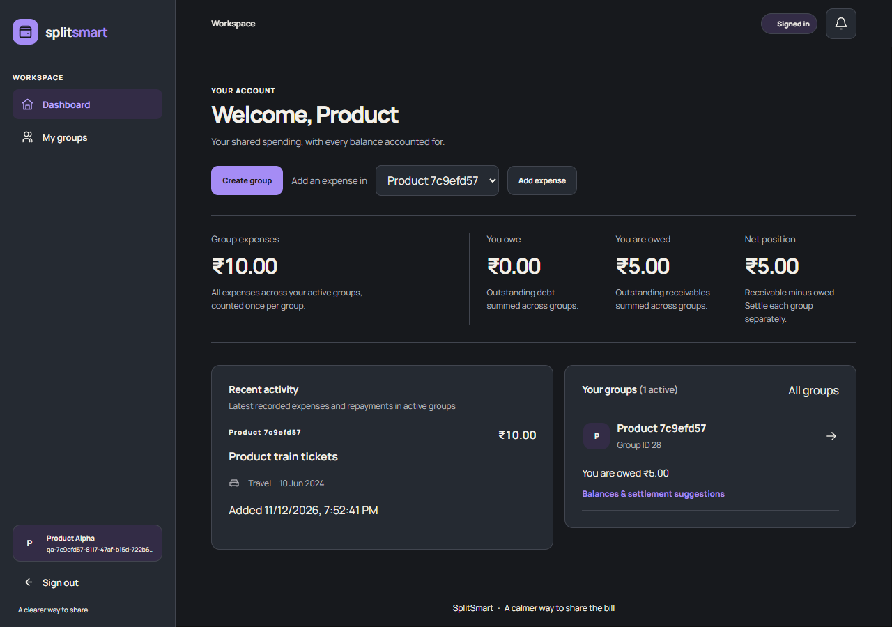
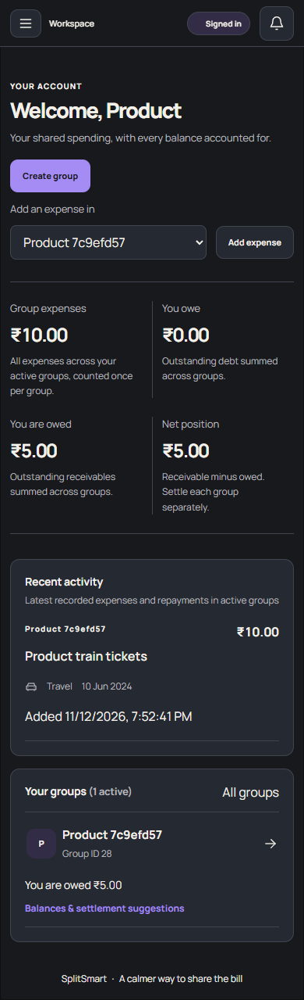

# SplitSmart

SplitSmart helps groups record shared expenses, understand balances and settle debts. The full-stack implementation uses Java 21, Spring Boot, React, MySQL/PostgreSQL and Flyway.

## Try the portfolio demo

[Open the offline portfolio demo](https://splitsmart-offline-demo.pages.dev/).
It is an interactive React simulation with fictional preset people and transactions. It has no Spring Boot API connection, database, email delivery or real account creation. State resets on refresh. The published demo is separate from the full-stack application.

[Two-minute walkthrough and application descriptions](docs/portfolio-application-kit.md).

## Implementation

- JWT authentication, BCrypt passwords and protected group operations.
- Equal/unequal expense splits, exact decimal amounts, balances and settlement suggestions. Circular obligations can net to zero without deleting the underlying expenses.
- Consent-based invitations, expiring/revocable invite links and persisted recipient-authorized notifications.
- Responsive dashboard, navigation and read-only account Settings.
- Password recovery with hashed, expiring single-use tokens, atomic consumption, throttling and server-validated JWT token versions.
- Brevo HTTPS delivery adapter; production email defaults to disabled. A separately approved two-email synthetic recovery test passed. No email is sent by the offline demo.

These describe the reviewed codebase, not a claim that every feature is deployed.

## Architecture

```text
Offline portfolio URL -> static React simulation -> fictional in-memory state
                        (no API/database connection)

Full-stack React client -> HTTPS Spring Boot API -> relational database
                           | JWT + authorization    | Flyway + constraints
                           | optional Brevo HTTPS   | exact decimal amounts
```

[API inventory](docs/API.md) · [Release artifact manifest](docs/release-candidate-artifacts.json) · [Current milestone status](MASTER-CTO-STATUS.md).

## Release identity

The compatible local frontend/backend candidate is `a1813f80d9c22e06ae89e2dd7f8b2ba6a0f02c16`. Later verification/documentation commits do not change its application source.

The most recent dashboard verification (12 November 2026) identified the existing [live frontend](https://splitsmart-92b.pages.dev/) as `bc59921336f148784317550a5f29202edbeda825` and [Render backend](https://splitsmart-backend-ydj2.onrender.com/api/health) as `418d757855dd10965c2872176022f93ac5e35a8a`. These are historical metadata observations, not a claim of a new deployment. Production MySQL was verified at Flyway V7 on 13 November. The local MySQL release requires additive V8–V10. PostgreSQL has a separate V1–V11 migration path; never substitute its history for MySQL history.

No production rollout is authorized. Never revert to an unversioned V7 backend after password resets: revoked JWTs must remain revoked. The offline demo source is independently pinned at `d58b0c7925266ef7fe7804dd7cc89c07fc66adb4`.

## Local development

Use a disposable local database only. Never run development or test commands against production or backup-derived recovery databases.

1. Install Java 21 and a Node version supported by the checked-in Vite release. Use the Maven wrapper and `frontend/package-lock.json`.
2. Configure private process environment: `DB_URL`, `DB_USERNAME`, `DB_PASSWORD`, and a strong `JWT_SECRET`. Keep secrets outside Git and command history. Default MySQL migrations run at startup; inspect the destination before starting.
3. From `backend`, run `./mvnw spring-boot:run` (Windows: `./mvnw.cmd spring-boot:run`).
4. From `frontend`, run `npm ci`, then `npm run dev`. Set `VITE_API_BASE_URL` to the local backend origin; set the backend `APP_CORS_ALLOWED_ORIGINS` to the actual local frontend origin.
5. Keep `RECOVERY_EMAIL_ENABLED=false`, `RECOVERY_EMAIL_DELIVERY_VERIFIED=false` and `VITE_EMAIL_ACTIONS_ENABLED=false`. Do not place a Brevo credential in frontend variables.

The PostgreSQL profile selects the separate migration directory. Managed PostgreSQL additionally requires certificate-validated TLS and separate runtime/migration credentials; follow the private deployment handoff instead of guessing a production URL.

## Verification

Existing evidence covers Java authorization/recovery/financial tests, React forms/dashboard/navigation, actual-backend responsive browser journeys, isolated MySQL V7→V10 rehearsals, PostgreSQL migration/reconciliation and rootless Java 21 container startup/TLS failures. Test batches apply to their recorded revisions and environments; they are not one universal test total or proof of production availability. See [milestone status](MASTER-CTO-STATUS.md) and the artifact manifest.

Frontend checks: `npm run lint`, `npm test`, `npm run build`. Backend: choose the focused test classes for the change using `./mvnw -Dtest=ClassName test`. Integration/browser runners require explicit isolated database identities. Do not replay the completed email harness: its two-message authorization is exhausted.

## Hosting and limitations

The public simulation uses Cloudflare Pages Free. The separate full-stack application uses Render Free and Aiven. Render can sleep after 15 idle minutes and has shared monthly quotas; this is best-effort portfolio hosting, not an availability guarantee ([official limits](https://render.com/docs/free)).

[Aiven MySQL Free retires on 21 December 2026](https://aiven.io/docs/products/mysql/howto/mysql-free-tier-migration-options); remaining services, data and backups will be deleted. Encrypted backups and local recovery checks exist, but later writes require a fresh approved snapshot and an independent protected copy is still pending.

[Aiven PostgreSQL Free](https://aiven.io/docs/products/postgresql/concepts/pg-free-tier) is a no-card alternative with limited storage/connections and no SLA. Compatibility is tested, but real-data cloud migration remains blocked by Privacy Option C: unexpected PostgreSQL primary error messages may include sensitive values in provider logs. A clean launch does not remove that future-data risk. Data disposition, privacy and release decisions remain with the owner.

Account editing is not implemented; Settings is read-only. Email delivery is disabled in production. Do not treat the offline simulation as evidence that the enhanced application has been deployed.

## Synthetic product screenshots

These existing local integration-test captures use generated `example.test` accounts and fictional transactions. They illustrate the full-stack dashboard, not the static demo or a newly deployed revision. Desktop/mobile captures were visually reviewed on 13 November 2026.





Earlier detailed setup and engineering notes are preserved in the [historical reference](README-HISTORICAL.md). Its status/provider observations are historical; use the current milestone status for release decisions.
